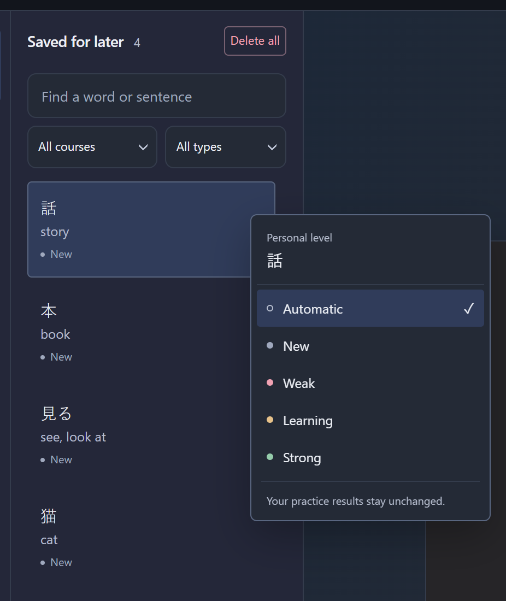

# iKnow! Reading Helper 1.41.1

## Added

**Personal learning levels**

Right-click a saved word or sentence to set its learning level.

- Choose New, Weak, Learning or Strong.
- Choose Automatic to use your practice results again.

## Improved

**Study details**

A cleaner look while you learn.

- A tidier Kana chart, without the extra character at the top.
- A neater course picker with clearer loading and error messages.
- A new Fill the gap icon.
- Clearer playback controls and a focused recording view.
- Full-width notes that reopen in read view, with smoother transitions.
- Less automatic processing on microphone recordings.
- Fill the gap now recognises the word forms used in iKnow examples.
- Delete a saved note directly from its panel.
- Switch between saved words and practice options without flashing.

Install through **Updates → Check for updates → Install update**. Pause preparation first. Existing settings, models and prepared courses are retained; no new model download is needed.
